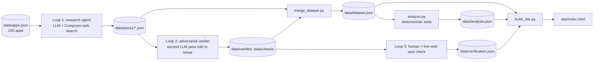

# App Buildability Research Agent: High-Level Design

An AI research pipeline that studies 100 popular apps for "agent-toolkit buildability": auth method, self-serve vs gated access, API surface, webhooks, official MCP support and a GREEN / YELLOW / RED verdict with evidence URLs, then clusters the results into patterns. Live case study at [buildability.minianon.in](https://buildability.minianon.in). For code-level detail see the [Low-Level Design](lld.md).

## 1. Pipeline

## 2. Components

| Script | Responsibility |
|---|---|
| `schema.py` | One JSON schema, verdict schema and rubric shared by every run, plus the research and verify prompts |
| `run_research.py` | For each app missing a record: web-search official docs through Composio tools, then force a schema-valid JSON record (structured output) |
| `verify.py` | Re-checks each key field and marks it CONFIRMED / WRONG / PARTIALLY_WRONG / UNVERIFIABLE with corrections |
| `merge_dataset.py` | Combines pass-1 records, verified corrections and manual overrides |
| `analyze.py` | Counts and clusters (no LLM) |
| `build_site.py` | Renders the single-page case study |

## 3. Design choices

| Choice | Reason |
|---|---|
| Same schema and rubric for every app | 100 independent runs stay comparable |
| Structured outputs | Every record is valid JSON with fixed enums |
| Adversarial second pass | Raises accuracy by actively trying to disprove pass 1 |
| Idempotent runs | Only apps without a record are researched, so rate-limited runs resume cleanly |
| Human in the loop | Rubric design, name disambiguation and final calls on unclear evidence |

## 4. Tech

| Item | Choice |
|---|---|
| Language | Python 3 |
| LLM | Anthropic Messages API with tool use and JSON-schema outputs |
| Tools | Composio SDK, `COMPOSIO_SEARCH` toolkit |
| Output | Static HTML site |
