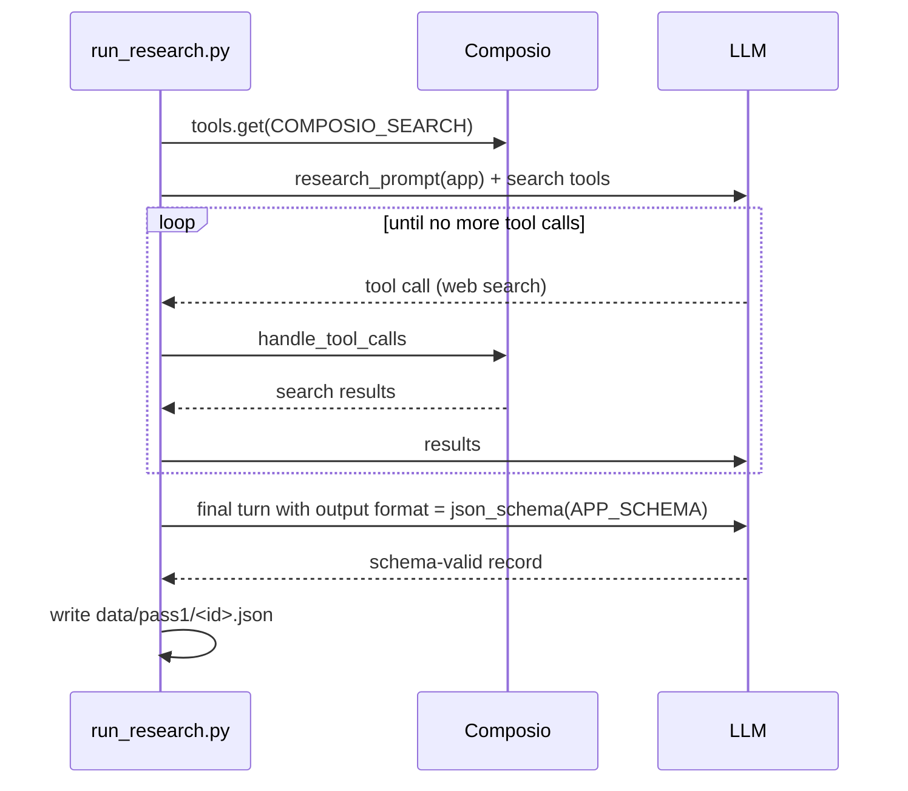

# App Buildability Research Agent: Low-Level Design

For the big picture see the [High-Level Design](hld.md).

## 1. Record schema (`APP_SCHEMA`)

| Field | Values |
|---|---|
| `id`, `name`, `category`, `one_liner` | From `apps.json` + research |
| `auth`, `primary_auth` | Auth methods found (OAuth 2.0, API key, …) |
| `access_model` | `SELF_SERVE_FREE`, `SELF_SERVE_TRIAL`, `APPROVAL_REQUIRED`, `PAID_PLAN_REQUIRED`, `PARTNER_GATED`, `NO_PUBLIC_API` |
| `api_styles`, `api_breadth` | REST / GraphQL / …; `BROAD`, `MODERATE`, `NARROW`, `NONE` |
| `webhooks` | Webhook support |
| `official_mcp` | `YES_OFFICIAL`, `COMMUNITY_ONLY`, `NONE_FOUND` |
| `buildability` | `GREEN`, `YELLOW`, `RED` |
| `main_blocker` | What stops an agent integration |
| `evidence` | Claims with official URLs |
| `confidence` | `HIGH`, `MEDIUM`, `LOW` |
| `source` | `agent` or `verified` |

Verifier output: per-field verdicts (`CONFIRMED`, `WRONG`, `PARTIALLY_WRONG`, `UNVERIFIABLE`) with corrected values, and an overall `CLEAN`, `MINOR_ERRORS` or `MAJOR_ERRORS`.

## 2. Research one app



## 3. Commands

```bash
python agent/run_research.py --limit 5     # first 5 apps without a record
python agent/run_research.py --ids 1 2 3   # specific apps
python agent/verify.py --ids 1 2 3         # adversarial verification
python agent/analyze.py --json             # recompute data/analysis.json
```

Environment: `COMPOSIO_API_KEY`, `ANTHROPIC_API_KEY`.

## 4. Analysis (`analyze.py`)

| Output | How |
|---|---|
| Counts per field | `counts(key)` over `dataset.json` |
| Per-category breakdown | `by_category(field)` |
| Self-serve vs gated | `SELF_SERVE` = free or trial; `GATED` = approval, paid plan, partner-gated or no public API |
| Source mix | Records still `agent` vs `verified` |
